# 🎓 Student Placement Prediction System Using Machine Learning

[](https://www.python.org/)
[](https://scikit-learn.org/)
[](https://streamlit.io/)
[](https://pandas.pydata.org/)
[](LICENSE)

An end-to-end Machine Learning system that analyzes academic performance, cognitive measures, and employability attributes to predict college student placement outcomes. Built with comparative classification models, rigorous cross-validation, and an interactive Streamlit dashboard.

---

## 📌 Overview

Campus placements are crucial milestones for students and academic institutions. Placement success depends on multiple interrelated factors including cumulative academic performance (CGPA), recent semester momentum, IQ, communication skills, technical project work, and internship experience. 

This project establishes a data-driven classification pipeline that predicts student placement likelihood, benchmarks multiple machine learning algorithms (Logistic Regression, Decision Tree, Random Forest, and Multi-Layer Perceptron), and provides actionable insights through an interactive web application.

---

## 👥 Project Team & Contributions

This project was built following the academic project synopsis specifications:

| Team Member | Roll No. | Primary Role & Module | Deliverables |
|:---|:---:|:---|:---|
| **Sachin** | — | **Data Collection, Cleaning & Preprocessing** | `src/data_preprocessing.py`, imputation, encoding, train-test splitting |
| **Uttkarsh** | — | **Exploratory Data Analysis & Feature Engineering** | `src/feature_engineering.py`, 11+ EDA visualisations, derived scores |
| **Vivek Ramen** | `240695` | **Logistic Regression & Decision Tree Models** | `src/train_models.py`, L1/L2 regularization sweeps, depth constraints |
| **Saket** | — | **Random Forest & Hyperparameter Tuning** | `src/train_models.py`, ensemble learning, GridSearchCV cross-validation |
| **Yash Bhargava** | `240942` | **Model Evaluation, Integration & Web Application** | `src/evaluate_models.py`, `app.py`, `predict.py`, project documentation |

---

## 📦 Dataset

- **Dataset Name:** College Student Placement Factors Dataset
- **Source:** [Kaggle Dataset by Sahil Islam](https://www.kaggle.com/datasets/sahilislam007/college-student-placement-factors-dataset)
- **Samples:** 10,000 student records
- **Format:** CSV (`data/college_student_placement.csv`)

### Features Used

| Feature Name | Type | Description | Range / Values |
|:---|:---:|:---|:---:|
| `IQ` | Numerical | Intelligence Quotient score | 41 – 158 |
| `Prev_Sem_Result` | Numerical | Previous semester GPA | 5.00 – 10.00 |
| `CGPA` | Numerical | Cumulative Grade Point Average | 4.54 – 10.46 |
| `Academic_Performance` | Numerical | Overall academic performance rating | 1 – 10 |
| `Internship_Experience` | Categorical | Prior internship experience completed | `Yes` / `No` |
| `Extra_Curricular_Score`| Numerical | Extracurricular and co-curricular score | 0 – 10 |
| `Communication_Skills` | Numerical | Soft skills & communication rating | 1 – 10 |
| `Projects_Completed` | Numerical | Completed technical projects | 0 – 5 |

### Target Variable

- **`Placement`**: Binary classification (`1` = Placed, `0` = Not Placed)
  - Class Distribution: ~83.4% Not Placed (`0`), ~16.6% Placed (`1`)

---

## 🛠️ Technologies & Tools

- **Programming Language**: Python 3.9 – 3.14
- **Data Manipulation**: NumPy, Pandas
- **Machine Learning & Preprocessing**: Scikit-Learn (`ColumnTransformer`, `Pipeline`, `StandardScaler`, `GridSearchCV`)
- **Data Visualization**: Matplotlib, Seaborn
- **Interactive Web UI**: Streamlit
- **Model Serialization**: Joblib

---

## 🤖 Machine Learning Models

### 1. Logistic Regression (Baseline & Regularized)
- Linear probabilistic classifier modeling the log-odds of placement.
- Features standardized with `StandardScaler` to prevent feature dominance.
- Regularization experiments conducted:
  - **L2 (Ridge)**: Shrinks coefficients uniformly to avoid overfitting.
  - **L1 (Lasso via SAGA solver)**: Drives non-essential feature weights to zero for sparse feature selection.

### 2. Decision Tree Classifier
- Non-parametric recursive splitting based on Gini Impurity and Information Gain (Entropy).
- Controlled using tree complexity parameters (`max_depth`, `min_samples_leaf`, `min_samples_split`) to avoid overfitting.

### 3. Random Forest Classifier (Ensemble Bagging)
- Ensemble of de-correlated decision trees trained with bootstrap aggregating (bagging) and random subspace feature selection.
- Tuned via `GridSearchCV` (`n_estimators`, `max_depth`, `max_features`, `min_samples_leaf`) using 5-fold stratified cross-validation.
- Generates Mean Decrease in Impurity (MDI) feature importances.

### 4. Multi-Layer Perceptron (MLP Neural Network)
- Feedforward artificial neural network with dense layers, ReLU hidden activations, and Adam optimizer.
- Evaluated with early stopping, validation monitoring, and L2 penalty (`alpha`) sweeps.

---

## 🔄 Project Workflow

```mermaid
flowchart LR
    A["1. Data Ingestion<br/>(10,000 Records)"] --> B["2. Preprocessing<br/>(Drop ID, Impute, Encode)"]
    B --> C["3. Feature Engineering<br/>(Academic Score, Skills Index)"]
    C --> D["4. Exploratory Data Analysis<br/>(Distributions, Correlations)"]
    D --> E["5. Model Training & Regularization<br/>(LR, DT, RF, MLP)"]
    E --> F["6. GridSearchCV Tuning<br/>(5-Fold Stratified CV)"]
    F --> G["7. Model Evaluation<br/>(Accuracy, F1, Confusion Matrix, ROC)"]
    G --> H["8. Interactive Deployment<br/>(Streamlit Web Application)"]
```



---

## 📊 Comprehensive Visualizations

The project generates high-resolution figures stored in `outputs/plots/`:

- **Placement Distribution (`placement_distribution.png`)**: Pie and bar representation of class balance.
- **CGPA Distribution (`cgpa_distribution.png`)**: Density KDE of CGPA contrasting placed vs. not-placed candidates.
- **IQ Distribution (`iq_distribution.png`)**: Comparative distribution of IQ scores.
- **Communication Skills Analysis (`communication_skills_analysis.png`)**: Placement probability vs. communication rating.
- **Projects Completed Analysis (`projects_completed_analysis.png`)**: Placement success by completed project volume.
- **Correlation Heatmap (`04_correlation_heatmap.png`)**: Pearson correlation matrix of all features.
- **Model Accuracy Comparison (`model_accuracy_comparison.png`)**: Side-by-side test-set accuracy bar chart.
- **Feature Importance Analysis (`feature_importance_analysis.png`)**: Top factors driving placement decisions.
- **Confusion Matrices (`09_confusion_matrices.png`)**: True Positive / False Positive breakdown across all models.
- **ROC Curves Overlay (`10_roc_curves.png`)**: Receiver Operating Characteristic curves with AUC scores.

---

## 📈 Results & Performance Comparison

Evaluated on the held-out 20% test set (2,000 samples) never seen during training or tuning:

| Model | Accuracy | Precision | Recall | F1-Score (Macro) | ROC-AUC |
|:---|:---:|:---:|:---:|:---:|:---:|
| **Logistic Regression (Baseline)** | 90.35% | 77.69% | 58.73% | 0.6690 | 0.9451 |
| **Logistic Regression (Tuned)** | 90.35% | 77.69% | 58.73% | 0.6690 | 0.9451 |
| **Decision Tree (Baseline)** | 100.00% | 100.00% | 100.00% | 1.0000 | 1.0000 |
| **Decision Tree (Tuned)** | 100.00% | 100.00% | 100.00% | 1.0000 | 1.0000 |
| **Random Forest (Baseline)** | 99.95% | 100.00% | 99.70% | 0.9985 | 1.0000 |
| **Random Forest (Tuned)** | 99.95% | 100.00% | 99.70% | 0.9985 | 1.0000 |
| **MLP Neural Network (Baseline)** | 99.05% | 97.00% | 97.29% | 0.9714 | 0.9992 |
| **MLP Neural Network (Tuned)** | 98.80% | 94.25% | 98.80% | 0.9647 | 0.9991 |

> **Primary Selection Metric:** **F1-Score** was selected as the deciding metric because it balances precision and recall on class-imbalanced data. Both tree-based and ensemble models demonstrate outstanding separation on this dataset.

---

## 🚀 Quick Start Guide

### 1. Prerequisites
Ensure you have Python 3.9+ installed and open a terminal in `student-placement-prediction`:

```powershell
# Navigate to project directory
cd "student-placement-prediction"

# Activate virtual environment
..\.venv\Scripts\Activate.ps1
```

### 2. Run the Full ML Pipeline
To clean data, run EDA, train all models with cross-validation, and evaluate results:

```powershell
..\.venv\Scripts\python.exe src\run_pipeline.py
```

### 3. Launch the Streamlit Web Application
To start the interactive prediction and analysis web app:

```powershell
..\.venv\Scripts\streamlit.exe run app.py
```
Open **http://localhost:8501** in your browser.

### 4. Run the Jupyter Notebooks
You can explore the project via either:
1. **Master Standalone Notebook**: Open `Student_Placement_Prediction_System.ipynb` directly in VS Code or Jupyter.
2. **Modular Topic Notebooks** in `notebooks/`:
   - `01_data_understanding.ipynb`
   - `02_eda_and_feature_engineering.ipynb`
   - `03_model_training_and_tuning.ipynb`
   - `04_deep_learning_mlp.ipynb`

---

## 🔮 Interactive Web Application Features

The Streamlit app (`app.py`) provides 4 complete sections:

1. **🔮 Predict Placement**:
   - Sliders for CGPA, Previous Semester GPA, IQ score, Academic Rating, Communication Skills, Projects, and Extra-curriculars.
   - Quick Profile Presets (**High Achiever**, **Balanced Average**, **Needs Support**).
   - Placement probability gauge, outcome badge, and profile summary.
2. **📊 Model Performance**:
   - Metric comparison table with color gradients.
   - Expandable high-res plots for Confusion Matrices, ROC Curves, Accuracy Comparison, and Feature Importance.
   - Academic breakdown of False Positives vs. False Negatives.
3. **📈 EDA Insights**:
   - Visualizations of all feature distributions and placement quartiles.
4. **ℹ️ About Project**:
   - Course synopsis, team contributions table, architecture specifications, and references.

---

## 📁 Repository Structure

```
student-placement-prediction/
├── README.md                                 ← Project documentation
├── requirements.txt                          ← Project dependencies
├── app.py                                    ← Interactive Streamlit web application
├── Student_Placement_Prediction_System.ipynb ← Self-contained executed master notebook
├── data/
│   ├── college_student_placement.csv         ← Active 10,000-sample dataset
│   └── college_student_placement_dataset.csv ← Kaggle source dataset
├── src/
│   ├── data_preprocessing.py                 ← Sachin: cleaning, encoding, ColumnTransformer
│   ├── feature_engineering.py                ← Uttkarsh: EDA visualizations, derived features
│   ├── train_models.py                       ← Vivek Ramen (LR, DT) & Saket (RF, GridSearch)
│   ├── deep_learning_model.py                ← MLP Neural Network implementation
│   ├── evaluate_models.py                    ← Yash Bhargava: metrics, plots, final selection
│   ├── predict.py                            ← Inference engine for single & batch prediction
│   └── run_pipeline.py                       ← Master automated end-to-end execution script
├── models/                                   ← Serialized .pkl pipelines
│   ├── final_model.pkl                       ← Production pipeline
│   ├── rf_tuned.pkl                          ← Tuned Random Forest
│   ├── dt_tuned.pkl                          ← Tuned Decision Tree
│   ├── lr_tuned.pkl                          ← Tuned Logistic Regression
│   └── mlp_tuned.pkl                         ← Tuned MLP Neural Network
├── outputs/
│   ├── model_comparison.csv                  ← Test-set comparative metrics
│   ├── tuning_summary.csv                    ← GridSearchCV hyperparameter records
│   └── plots/                                ← Generated charts & plots
└── notebooks/
    ├── 01_data_understanding.ipynb
    ├── 02_eda_and_feature_engineering.ipynb
    ├── 03_model_training_and_tuning.ipynb
    └── 04_deep_learning_mlp.ipynb
```

---

## 📚 References

1. Islam, S. (2024). *College Student Placement Factors Dataset*. Kaggle.
2. Breiman, L. (2001). *Random Forests*. Machine Learning, 45(1), 5–32.
3. Pedregosa et al. (2011). *Scikit-learn: Machine Learning in Python*. JMLR, 12, 2825–2830.
